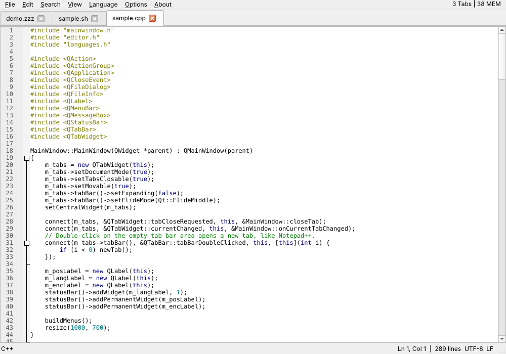
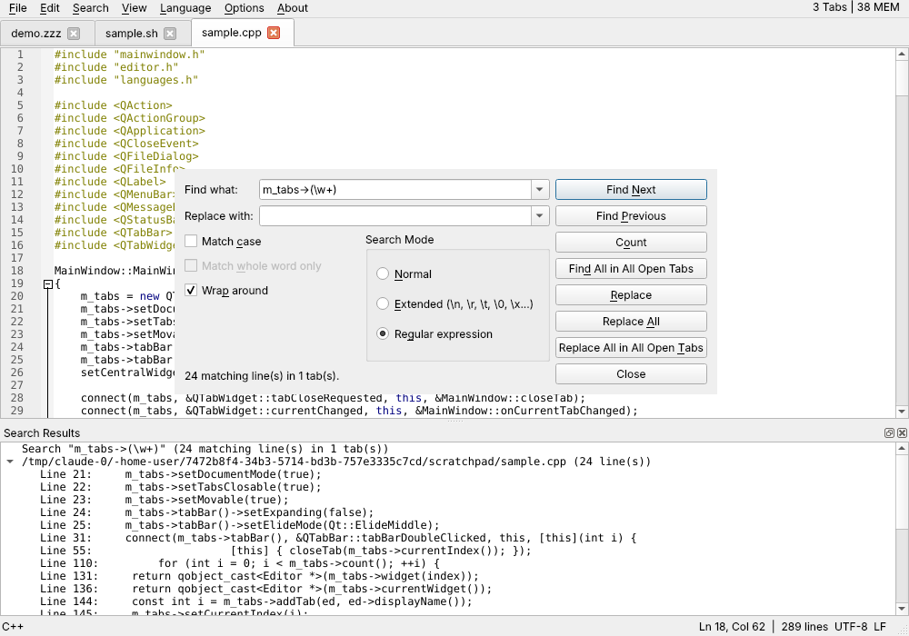
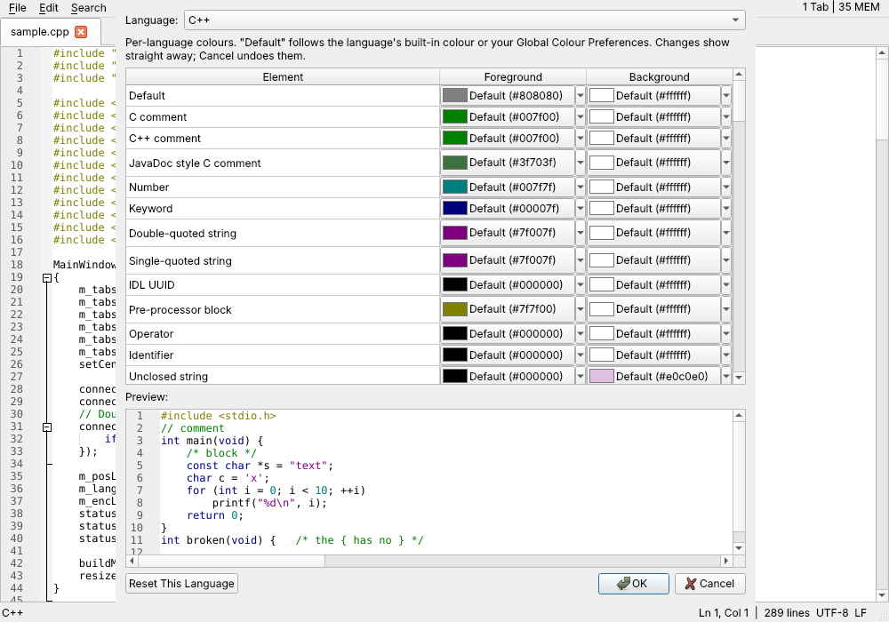
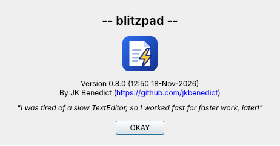

<div align="center">


# BlitzPad

**A blazing-fast text and code editor for Linux, in the spirit of Notepad++.**

*"I was tired of a slow TextEditor, so I worked fast for faster work, later!"*


[Features](#-features) ·
[Install](#-install) ·
[Beta status](#-beta-status--road-to-10) ·
[Preferences](#-preferences) ·
[Changelog](CHANGELOG.md)

</div>

---

> [!IMPORTANT]
> **This is the BlitzPad beta (0.10).** Every feature planned for the first release is in
> and covered by automated tests on Ubuntu 24.04 / Zorin OS 18. **Next up: a full QA pass
> across distributions and desktops, then Build 1.0.** See
> [Beta status & road to 1.0](#-beta-status--road-to-10), and please
> [report anything odd](#-help-test-the-beta).

## ⚡ Why BlitzPad?

GNOME's default Text Editor (the one Zorin OS ships) can take *seconds* to open even a small
file. BlitzPad opens in **about 40 ms**, uses **about 35 MB of RAM**, and gives you what
Windows users get from Notepad++: tabs, real syntax colouring, and serious search and
replace with regular expressions.

Under the hood it is native C++17 with Qt 6 and **QScintilla**, the Qt port of Scintilla,
the same editing engine Notepad++ is built on. There's no Electron and no web view.

<div align="center">

</div>

## ✨ Features

<table>
<tr><td width="50%" valign="top">

### ✏️ Editing
- Tabs: open many files at once, switch with Ctrl+Tab or Ctrl+PgUp/PgDn
- Syntax colouring for **18 languages**: C, C++, Bash, JavaScript/TypeScript, JSON,
  Python, HTML, CSS, XML, Markdown, Makefile, CMake, YAML, INI, Diff, SQL, Java
  and plain text
- Line numbers, code folding, brace matching (**unmatched braces glow red**)
- Multiple cursors, Alt+drag column selection
- Duplicate line (Ctrl+D), toggle comment (Ctrl+Q), word wrap, zoom
- Keeps each file's encoding and line endings; saves are atomic

</td><td width="50%" valign="top">

### 🔍 Find & Replace
- **Normal**, **Extended** (`\n \t \xHH`…) and **Regex** modes
- Regex groups in replacements (`\1`…`\9`)
- Count, Replace All (one undo step)
- **Replace All in All Open Tabs**
- **Find All in All Open Tabs** with a clickable results panel (F7)
- Go to Line (Ctrl+G)

</td></tr>
<tr><td valign="top">

### 🎨 Make it yours
- **Options › Global Colour Preferences**: every editor colour
- **Options › Grammar Colour Overrides**: every syntax colour, for every language,
  with a live preview
- **Options › Create File Format…**: define your *own* language (comments,
  strings, keywords, operators, folding, colours) with no code
- Every setting and key binding lives in `~/.blitzpad/preferences.ini`

</td><td valign="top">

### 🧰 Handy extras
- **Smart format detection**. For unknown files it asks: plain text, or create a format?
- **Save Compressed**: ZIP, 7z, GZip, BZip2, TAR, with an AES-256 password for ZIP/7z
- **"X Tabs | Y MEM"** live counter in the menu bar
- One-command install for **just you** or **all users**, with icon and menu entry

</td></tr>
</table>

<details>
<summary><b>📸 More screenshots</b></summary>
<br>

| Find / Replace with results panel | Grammar Colour Overrides |
|---|---|
|  |  |
| **Unknown file? You choose.** | **About** |
|  |  |

</details>

## 🚀 Install

```sh
unzip blitzpad-0.10.zip && cd blitzpad
./install.sh
```

That's it. `install.sh`:

1. **Checks your system.** It detects your distribution, lists missing packages, and offers to
   install them with your package manager.
2. **Builds and tests.** It compiles BlitzPad and runs the automated tests.
3. **Installs it where you choose:**

| | 👤 Just for me (`--user`) | 👥 All users (`--system`, sudo) |
|---|---|---|
| Program | `~/.local/bin/blitzpad` | `/usr/bin/blitzpad` |
| Menu entry | `~/.local/share/applications/` | `/usr/share/applications/` |
| Icon | `~/.local/share/icons/hicolor/…` | `/usr/share/icons/hicolor/…` and `/usr/share/pixmaps/` |

Then it refreshes the icon and menu caches, so BlitzPad shows up in your applications menu
with its icon. If the icon doesn't appear straight away, log out and back in.

<details>
<summary><b>Installer options</b></summary>

| Option | Does |
|---|---|
| `--user` / `--system` | Skip the "where" question |
| `-y` | Answer yes to everything (unattended) |
| `--skip-build` | Install what's already built in `./build` |
| `--package` | Also make a release zip (raises the version number) |
| `--uninstall` | Remove BlitzPad (your settings in `~/.blitzpad/` stay) |

`./build.sh` on its own just builds and tests. You can also run BlitzPad without
installing: `./build/blitzpad [files…]`.

</details>

### Supported systems

| System | Package manager | Beta status |
|---|---|---|
| **Zorin OS 18**, Ubuntu 24.04+, Debian 12+, Linux Mint 22+, Pop!_OS 24.04 | apt | ✅ Built & tested (Ubuntu 24.04) |
| Zorin OS 17, Ubuntu 22.04, Linux Mint 21 | apt | 🧪 Expected to work, in 1.0 QA |
| Fedora 39+ | dnf | 🧪 Expected to work, in 1.0 QA |
| Arch Linux, Manjaro, EndeavourOS | pacman | 🧪 Expected to work, in 1.0 QA |
| openSUSE Tumbleweed / Leap 15.6 | zypper | 🧪 Expected to work, in 1.0 QA |

Works with GNOME, KDE Plasma, Xfce, Cinnamon, MATE and others, on X11 and Wayland.

<details>
<summary><b>📦 Packages needed (the installer handles these for you)</b></summary>
<br>

**Required to build:** a C++ compiler, CMake, Qt 6 (Widgets) and QScintilla for Qt 6.
**Recommended:** the Qt Wayland plugin, 7-Zip (for Save Compressed), monospace fonts with wide
Unicode coverage, and UTF-8 locale data.

| | Zorin / Ubuntu / Debian / Mint | Fedora | Arch | openSUSE |
|---|---|---|---|---|
| Compiler | `build-essential` | `gcc-c++ make` | `base-devel` | `gcc-c++ make` |
| CMake | `cmake` | `cmake` | `cmake` | `cmake` |
| Qt 6 | `qt6-base-dev` | `qt6-qtbase-devel` | `qt6-base` | `qt6-base-devel` |
| QScintilla | `libqscintilla2-qt6-dev` | `qscintilla-qt6-devel` | `qscintilla-qt6` | `qscintilla-qt6-devel` |
| Wayland | `qt6-wayland` | `qt6-qtwayland` | `qt6-wayland` | `qt6-wayland` |
| 7-Zip | `p7zip-full` | `p7zip p7zip-plugins` | `7zip` | `7zip` |
| Fonts | `fonts-dejavu-core fonts-noto-mono` | `dejavu-sans-mono-fonts google-noto-sans-mono-fonts` | `ttf-dejavu noto-fonts` | `dejavu-fonts google-noto-sans-mono-fonts` |
| Locale | `locales` | `glibc-langpack-en` | (in `glibc`) | `glibc-locale` |

**Fonts:** DejaVu Sans Mono and Noto Mono cover accented letters, Greek, Cyrillic,
box-drawing and most symbols, so nothing shows up as empty boxes. You can pick any font
with `font-family` and `font-size` under `[editor]` in preferences.ini.
**Locale:** BlitzPad works in UTF-8, and the installer checks that your system has a UTF-8 locale.

</details>

## ⚙️ Preferences

Everything lives in **`~/.blitzpad/`**. BlitzPad checks it on every start and recreates
anything missing with sensible defaults.

```
~/.blitzpad/
├── preferences.ini     every setting, key binding and colour
└── languages/          your own file formats (one .ini each) + README.txt
```

| Section | What it holds |
|---|---|
| `[editor]` | font, size, tab width, tabs vs spaces, line numbers, folding, brace matching, auto-indent, indent guides, current-line highlight, caret width, long-line marker |
| `[colours]` | global colours, e.g. `text-bg=#1e1e1e` |
| `[grammar-<language>]` | per-language colours; `default` means "inherit" |
| `[shortcuts]` | one line per menu command, e.g. `file.save-compressed=Ctrl+Shift+K` |
| `[view]` · `[file-types]` · `[window]` · `[compress]` | view toggles, plain-text extensions, window size, last archive format |

Edit it with **Options › Edit preferences.ini**, then **Options › Reload Preferences**.

## 🧪 Beta status & road to 1.0

**0.10 is feature-complete for the beta.** Every item from the original plan except
inactive-tab memory saving is in, and it has automated tests for search and Save Compressed.
Before calling it **Build 1.0**, BlitzPad goes through a dedicated **QA pass**:

- [ ] **Distributions.** Install and use on Zorin 17 & 18, Ubuntu 22.04, Debian 12, Mint, Fedora, Arch, openSUSE
- [ ] **Desktops.** GNOME (X11 and Wayland), KDE Plasma, Xfce, Cinnamon: icon, menu entry, dialogs, HiDPI
- [ ] **Big & awkward files.** 100 MB+ files, very long lines, binary files, Latin-1 and CRLF round trips
- [ ] **Find / Replace.** Regex edge cases, Replace All in All Open Tabs, undo
- [ ] **Save Compressed.** Every format, with and without passwords, opened in other archive tools
- [ ] **Your own file formats.** Folding by tokens and by indentation, editing and deleting formats
- [ ] **Preferences.** Hand-edited and broken `preferences.ini`, a deleted `~/.blitzpad/`, rebound shortcuts
- [ ] **Installer.** `--user` and `--system`, upgrades over older versions, `--uninstall`
- [ ] **Memory.** Free undo and highlighting data in inactive tabs (the last planned feature)
- [ ] **Release.** Choose the licence (it must be GPL-3.0 compatible, because QScintilla is GPL-3.0), final icon, `.deb` package

When the boxes are ticked, **Build 1.0** ships. 🎉

### 🐞 Help test the beta

Found something odd? Open an issue with:

- your distribution and desktop (e.g. *Zorin OS 18, GNOME on Wayland*)
- the output of `blitzpad --version`
- what you did, what you expected, and what happened, plus a screenshot if you can
- if it's about settings, the relevant part of `~/.blitzpad/preferences.ini`

## 🛠️ Developing

```sh
cmake -S . -B build && cmake --build build -j$(nproc)
ctest --test-dir build                       # automated tests
./build/blitzpad --version
./build/blitzpad --startup-time somefile.c   # measure start-up speed
bash package.sh                              # bump version, build, test, zip
```

The version lives only in `CMakeLists.txt`. Every change goes in [CHANGELOG.md](CHANGELOG.md).

<div align="center">
<br>

**BlitzPad**, by [JK Benedict](https://github.com/jkbenedict)

<sub>Built on <a href="https://www.riverbankcomputing.com/software/qscintilla/">QScintilla</a> · <a href="https://www.scintilla.org/">Scintilla</a> · <a href="https://www.qt.io/">Qt 6</a></sub>

</div>
