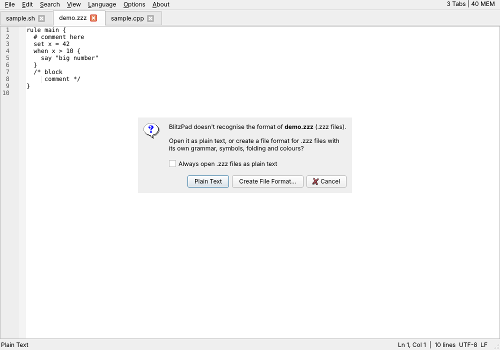
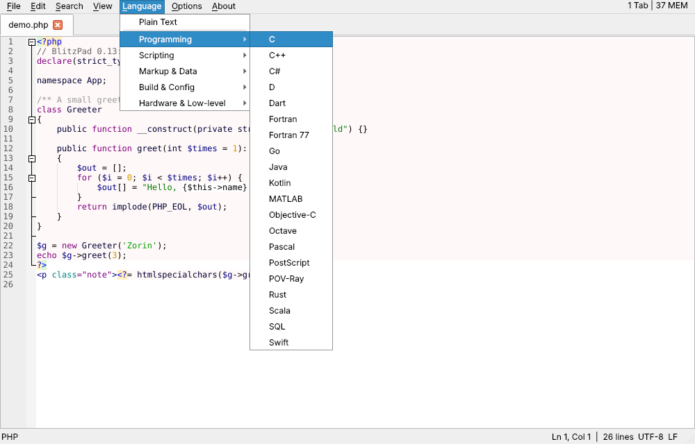
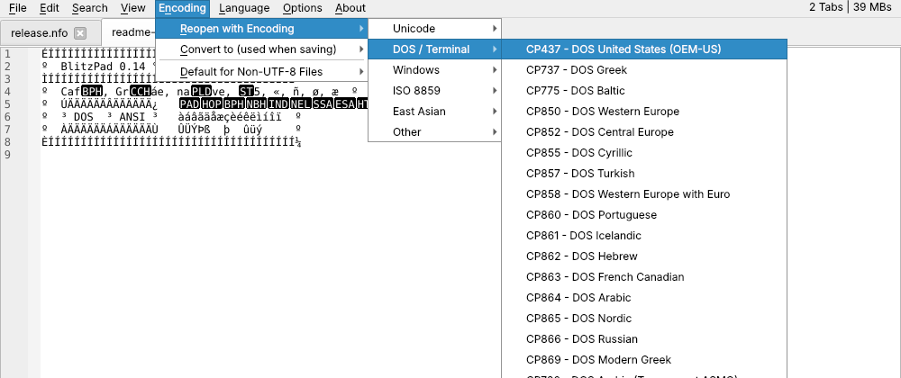
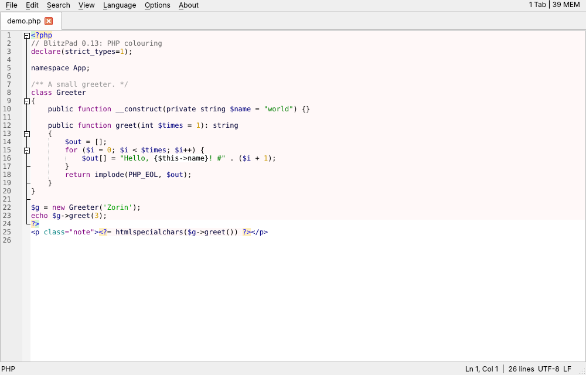
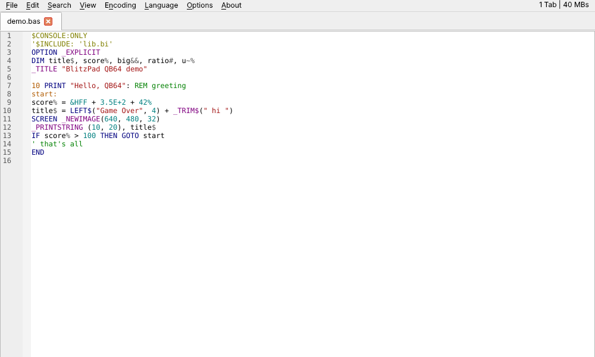
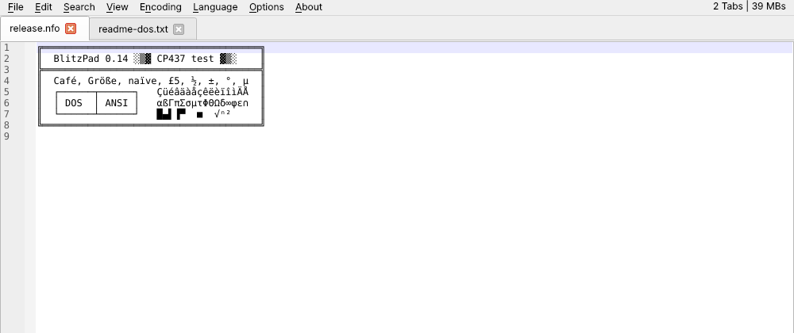

<div align="center">


# BlitzPad

**A blazing-fast text and code editor for Linux, in the spirit of Notepad++.**

*"I was tired of a slow TextEditor, so I worked fast for faster work, later!"*


[](LICENSE.md)

[Features](#-features) ·
[Install](#-install) ·
[Beta status](#-beta-status--road-to-10) ·
[Preferences](#-preferences) ·
[Changelog](CHANGELOG.md) ·
[License](LICENSE.md)

</div>

---

> [!IMPORTANT]
> **This is the BlitzPad beta (0.24).** Every feature planned for the first release is in
> and covered by automated tests. It is tested on **Zorin OS 18** (Debian / Ubuntu family) and
> **AlmaLinux 9 / 10** (RHEL family), so it has been tested on both Debian-based and
> RHEL-based systems, with native `.deb` and `.rpm` packages. **Next up: a full QA pass
> across distributions and desktops, then Build 1.0.** See
> [Beta status & road to 1.0](#-beta-status--road-to-10), and please
> [report anything odd](#-help-test-the-beta).

## ⚡ Why BlitzPad?

GNOME's default Text Editor (the one Zorin OS ships) can take *seconds* to open even a small
file. BlitzPad opens in **about 40 ms**, uses **about 35 MB of RAM**, and gives you what
Windows users get from Notepad++: tabs, real syntax colouring, and serious search and
replace with regular expressions.

Under the hood it is native C++17 with Qt 6 and **QScintilla**, the Qt port of Scintilla,
the same editing engine Notepad++ is built on. There's no Electron and no web view.

<div align="center">

</div>

## ✨ Features

<table>
<tr><td width="50%" valign="top">

### ✏️ Editing
- Tabs: open many files at once, switch with Ctrl+Tab or Ctrl+PgUp/PgDn
- Syntax colouring for **60 languages**, including PHP, QB64, C/C++, Python, Bash, Go, Rust,
  JavaScript/TypeScript, HTML/CSS and Markdown, each detected automatically
  ([full list](#-supported-languages))
- Line numbers, code folding, brace matching (**unmatched braces glow red**)
- Multiple cursors, Alt+drag column selection
- Duplicate line (Ctrl+D), toggle comment (Ctrl+Q), word wrap, zoom
- **Smart auto-indent**: indent with Tab and Enter keeps your tabs on the next line;
  press Enter again on that untouched indented line and the indent is dropped, so the
  blank line has no stray tab and the next line starts at the left edge
- **59 character encodings**: UTF-8/16, DOS and terminal code pages (CP437, CP850,
  CP866, KOI8-R…), Windows, ISO-8859 and East Asian ([list](#-character-encodings))
- Keeps each file's encoding and line endings; saves are atomic

</td><td width="50%" valign="top">

### 🔍 Find & Replace
- **Normal**, **Extended** (`\n \t \xHH`…) and **Regex** modes
- Regex groups in replacements (`\1`…`\9`)
- Count, Replace All (one undo step)
- **Replace All in All Open Tabs**
- **Find All in All Open Tabs** with a clickable results panel (F7)
- Go to Line (Ctrl+G)

</td></tr>
<tr><td valign="top">

### 🎨 Make it yours
- **Options › Global Colour Preferences**: every editor colour
- **Options › Grammar Colour Overrides**: every syntax colour, for every language,
  with a live preview
- **Options › Create File Format…**: define your *own* language (comments,
  strings, keywords, operators, folding, colours) with no code
- Every setting and key binding lives in `~/.blitzpad/preferences.ini`

</td><td valign="top">

### 🧰 Handy extras
- **Smart format detection**. For unknown files it asks: plain text, or create a format?
- **Save Compressed**: ZIP, 7z, GZip, BZip2, TAR, with an AES-256 password for ZIP/7z
- **"X Tabs | Y MBs"** live counter in the menu bar
- **Run with F5** (Options › Run): run, compile or automate the current file per language,
  with results in an Error Screen or Info window (see "Run (F5)" below)
- One-command install for **just you** or **all users**, with icon and menu entry

</td></tr>
</table>

<details>
<summary><b>📸 More screenshots</b></summary>
<br>

| Find / Replace with results panel | Grammar Colour Overrides |
|---|---|
|  |  |
| **Unknown file? You choose.** | **About** |
|  |  |
| **Language menu, grouped** | **Encoding menu** |
|  |  |

</details>

## 🚀 Install

```sh
unzip blitzpad-0.24.zip -d blitzpad && cd blitzpad
./install.sh
```

This works the same on Zorin / Ubuntu / Debian (apt) and on AlmaLinux / Rocky / RHEL (dnf).

### 🎩 On AlmaLinux and other RHEL-based systems

BlitzPad is tested on **AlmaLinux 9 and 10**. Rocky Linux, RHEL, CentOS Stream and Oracle
Linux 9+ use the same steps and are expected to work.

**Option 1: install with `install.sh`** (builds from source, installs to `/usr/local`)

```sh
sudo dnf install unzip
unzip blitzpad-0.24.zip -d blitzpad && cd blitzpad
./install.sh
```

The installer lists what's missing, asks once, and then with `sudo`: enables the **EPEL**
and **CRB** repositories, installs the compiler, CMake, Qt 6 and the rest with `dnf`, and
builds QScintilla from source if EPEL doesn't have it.

**Option 2: build and install the `.rpm`** (installs to `/usr`, managed by `dnf`)

```sh
cd blitzpad                                    # the unzipped release
bash packaging/build-rpm.sh                    # writes blitzpad-0.24.0-1.el9.x86_64.rpm next to the folder
sudo dnf install ../blitzpad-0.24.0-1.el9.*.rpm
```

`build-rpm.sh` offers to install `rpm-build`, the build tools and the CRB repository with
`sudo`. The finished `.rpm` has QScintilla built in, so installing it needs only Qt 6 from
AppStream, not EPEL. On AlmaLinux 10 the file name ends in `.el10.x86_64.rpm`. Remove it
with `sudo dnf remove blitzpad`.

That's it. `install.sh`:

1. **Checks your system.** It detects your distribution, lists the missing packages
   (required and recommended separately), asks before changing anything, and installs them
   with `sudo` through your package manager: `apt` on Zorin / Ubuntu / Debian / Mint, `dnf`
   on Fedora and AlmaLinux / Rocky / RHEL. On the RHEL family it also offers to enable the
   **EPEL** and **CRB** repositories, which hold some of the packages. If your distribution
   has no QScintilla package, it downloads the QScintilla source and builds it into
   BlitzPad, so nothing extra has to be installed.
2. **Builds and tests.** It compiles BlitzPad and runs the automated tests.
3. **Installs it where you choose:**

| | 👥 All users (`--system`, sudo) | 👤 Just for me (`--user`) |
|---|---|---|
| Program | `/usr/local/bin/blitzpad` | `~/.local/bin/blitzpad` |
| Menu entry | `/usr/local/share/applications/` | `~/.local/share/applications/` |
| Icon | `/usr/local/share/icons/hicolor/…` | `~/.local/share/icons/hicolor/…` |

It asks **"Install BlitzPad for all users?"** first; answer No to install just for you.
All-users installs go in `/usr/local`, where Zorin, Ubuntu, Debian, Fedora, AlmaLinux and
the other supported distros expect software you install yourself (`/usr/bin` belongs to the
package manager). On a system it doesn't recognise, it uses `/usr`. The full list of
dependencies and installed files for each distro is in [MANIFEST.md](MANIFEST.md).

Then it refreshes the icon and menu caches, so BlitzPad shows up in your applications menu
with its icon. If the icon doesn't appear straight away, log out and back in.

<details>
<summary><b>Installer options</b></summary>

| Option | Does |
|---|---|
| `--user` / `--system` | Skip the "all users?" question |
| `--prefix=DIR` | With `--system`, install under `DIR` (for example `--prefix=/usr`) |
| `-y` | Answer yes to everything (unattended) |
| `--skip-deps` | Don't check for or install missing packages |
| `--skip-build` | Install what's already built in `./build` |
| `--package` | Also make a release zip (raises the version number) |
| `--uninstall` | Remove BlitzPad (your settings in `~/.blitzpad/` stay) |

`./deps.sh` on its own only checks and installs packages (`./deps.sh --check` just lists
what's missing). `./build.sh` on its own checks packages, builds and tests. You can also run BlitzPad without
installing: `./build/blitzpad [files…]`.

</details>

### 📦 .deb and .rpm packages

Each beta also comes as native packages, which install to `/usr` and pull in their
dependencies automatically:

```sh
sudo apt install ./blitzpad_0.24.0-1_amd64.deb        # Zorin OS 18, Ubuntu 24.04+, Mint 22+, Debian 13
sudo dnf install ./blitzpad-0.24.0-1.el9.x86_64.rpm   # AlmaLinux / Rocky / RHEL 9
```

The `.deb` is ready to install. For AlmaLinux, the beta ships the source package
(`blitzpad-0.24.0-1.src.rpm`): make the installable `.rpm` on your Alma machine with
`bash packaging/build-rpm.sh` from the unzipped release. It offers to install `rpm-build`,
the build tools and the CRB repository with sudo, then writes the `.rpm` next to the
folder. (`rpmbuild --rebuild blitzpad-0.24.0-1.src.rpm` works too, once the build tools
are installed.) `bash packaging/build-deb.sh` makes the `.deb` the same way on Debian /
Ubuntu / Zorin. Remove them with `sudo apt remove blitzpad` or
`sudo dnf remove blitzpad`.

### Supported systems

BlitzPad is **tested on Debian-based systems** (Zorin OS 18) **and RHEL-based systems**
(AlmaLinux 9 / 10). The rest are expected to work and are part of the 1.0 QA pass.

| System | Package manager | Beta status |
|---|---|---|
| **Zorin OS 18** | apt (`.deb` or `install.sh`) | ✅ Tested |
| **AlmaLinux 9 / 10** | dnf + EPEL + CRB (`.rpm` or `install.sh`) | ✅ Tested |
| Zorin OS 17, Ubuntu 22.04+, Debian 12+, Linux Mint 21+, Pop!_OS 24.04 | apt | 🧪 Expected to work, in 1.0 QA |
| Rocky Linux, RHEL, CentOS Stream, Oracle Linux 9+ | dnf + EPEL + CRB | 🧪 Expected to work, in 1.0 QA |
| Fedora 39+ | dnf | 🧪 Expected to work, in 1.0 QA |
| Arch Linux, Manjaro, EndeavourOS | pacman | 🧪 Expected to work, in 1.0 QA |
| openSUSE Tumbleweed / Leap 15.6 | zypper | 🧪 Expected to work, in 1.0 QA |

Works with GNOME, KDE Plasma, Xfce, Cinnamon, MATE and others, on X11 and Wayland.

<details>
<summary><b>📦 Packages needed (the installer handles these for you)</b></summary>
<br>

**Required to build:** a C++ compiler, CMake, Qt 6 (Widgets) and QScintilla for Qt 6.
**Recommended:** the Qt Wayland plugin, 7-Zip (for Save Compressed), monospace fonts with wide
Unicode coverage, and UTF-8 locale data.

| | Zorin / Ubuntu / Debian / Mint | Fedora | AlmaLinux / Rocky / RHEL | Arch | openSUSE |
|---|---|---|---|---|---|
| Compiler | `build-essential` | `gcc-c++ make` | `gcc-c++ make` | `base-devel` | `gcc-c++ make` |
| CMake | `cmake` | `cmake` | `cmake` | `cmake` | `cmake` |
| Qt 6 | `qt6-base-dev` | `qt6-qtbase-devel` | `qt6-qtbase-devel` (AppStream + CRB) | `qt6-base` | `qt6-base-devel` |
| QScintilla | `libqscintilla2-qt6-dev` | `qscintilla-qt6-devel` | `qscintilla-qt6-devel` (EPEL), or built from source | `qscintilla-qt6` | `qscintilla-qt6-devel` |
| Wayland | `qt6-wayland` | `qt6-qtwayland` | `qt6-qtwayland` | `qt6-wayland` | `qt6-wayland` |
| 7-Zip | `p7zip-full` or `7zip` | `7zip` or `p7zip-plugins` | `7zip` or `p7zip-plugins` (EPEL) | `7zip` | `7zip` |
| Fonts | `fonts-dejavu-core fonts-noto-mono` | `dejavu-sans-mono-fonts google-noto-sans-mono-fonts` | `dejavu-sans-mono-fonts google-noto-sans-mono-fonts` | `ttf-dejavu noto-fonts` | `dejavu-fonts google-noto-sans-mono-fonts` |
| Locale | `locales` | `glibc-langpack-en` | `glibc-langpack-en` | (in `glibc`) | `glibc-locale` |

**AlmaLinux / Rocky / RHEL:** the installer enables EPEL (`epel-release`) and CRB
(`crb enable`, or `subscription-manager` on RHEL) after you say yes. Where EPEL has no
`qscintilla-qt6-devel`, it downloads QScintilla 2.14.1 (checksum-checked) into
`third_party/` and compiles it into BlitzPad as a static library.

**Fonts:** DejaVu Sans Mono and Noto Mono cover accented letters, Greek, Cyrillic,
box-drawing and most symbols, so nothing shows up as empty boxes. You can pick any font
with `font-family` and `font-size` under `[editor]` in preferences.ini.
**Locale:** BlitzPad works in UTF-8, and the installer checks that your system has a UTF-8 locale.

</details>

## ⚙️ Preferences

Everything lives in **`~/.blitzpad/`**. BlitzPad checks it on every start and recreates
anything missing with sensible defaults.

```
~/.blitzpad/
├── preferences.ini     every setting, key binding and colour
└── languages/          your own file formats (one .ini each) + README.txt
```

| Section | What it holds |
|---|---|
| `[editor]` | font, size, tab width, tabs vs spaces, line numbers, folding, brace matching, auto-indent, indent guides, current-line highlight, caret width, long-line marker |
| `[colours]` | global colours, e.g. `text-bg=#1e1e1e` |
| `[grammar-<language>]` | per-language colours; `default` means "inherit" |
| `[run-<language>]` | what F5 does for that language: `mode`, `run-with`, `automate`, `automate-stop-on-error` |
| `[shortcuts]` | one line per menu command, e.g. `file.save-compressed=Ctrl+Shift+K` |
| `[view]` · `[file-types]` · `[window]` · `[compress]` | view toggles, plain-text extensions, window size, last archive format |

Edit it with **Options › Edit preferences.ini**, then **Options › Reload Preferences**.

## ▶️ Run (F5)

**Options › Run** (or **F5**) runs the file you're editing. What it runs is set up once per
language, in one of two ways:

| | **Run with...** | **Automate as...** |
|---|---|---|
| What it is | One command the file is passed to, e.g. `python3` | Any number of system commands, one per line, run top to bottom |
| Good for | Scripts: Python, Bash, PHP, Perl, Ruby, Lua, QB64... | Compiling, `make`, running, copying, deploying: anything your system can do |
| Results | The **Error Screen**: output and errors (errors in red), and the exit code | The **Info** window: each command's output, OK or FAILED, and an overall SUCCESS or FAILED |

If nothing is set up for the current language, F5 asks which one you'd like. Change it any
time with **Options › Run with...** or **Options › Automate as...** (each has a Remove button).

In both, `%current_filename%` is the file's full path, `%current_dir%` its folder and
`%current_name%` its name without folder or extension. They're quoted for you, so names with
spaces work. "Run with" adds the file to the end of the command unless you place
`%current_filename%` yourself. For example, Automate as for C:

```sh
# build, run, keep a copy
gcc -Wall %current_filename% -o %current_name%
./%current_name%
cp %current_name% ~/bin/
```

- Commands run with `/bin/sh` in the file's folder, **in the background**: BlitzPad stays
  responsive, output appears as it arrives, and **Stop** ends a run.
- **Unsaved changes are saved first**, because the command works on the file on disk. A new,
  never-saved file asks for a name first.
- Automate as stops at the first failing command unless you untick that option. Lines
  starting with `#` are notes.
- Settings are saved per language in `[run-<language>]` of preferences.ini, and F5 can be
  rebound in `[shortcuts]` (`options.run`).

## 🌐 Supported languages

BlitzPad colours **60 languages** out of the box. It picks the language from the file's
extension, its name (`Makefile`, `Dockerfile`, `Gemfile`…) or its first line (`#!` lines
such as `#!/usr/bin/env php`, `<?php`, `<?xml`, `<!DOCTYPE html>`, `%!PS`, `\documentclass`).
You can always switch with the **Language** menu, which groups them like this:

| Group | Languages (extensions) |
|---|---|
| **Programming** | C (`.c .h`), C++ (`.cpp .cc .cxx .hpp .ino`…), C# (`.cs`), D (`.d`), Dart (`.dart`), Fortran (`.f90 .f95 .f03 .f08`), Fortran 77 (`.f .for .f77`), Go (`.go`), Java (`.java`), Kotlin (`.kt .kts`), MATLAB (`.m`), Objective-C (`.mm`, or `.m` starting with `#import`), Octave (`#!` octave), Pascal (`.pas .pp .dpr .lpr`), PostScript (`.ps .eps`), **QB64 / QBasic** (`.bas .bi .bm`), POV-Ray (`.pov`), Rust (`.rs`), Scala (`.scala .sc`), SQL (`.sql`), Swift (`.swift`) |
| **Scripting** | AviSynth (`.avs`), Bash/shell (`.sh .bash .zsh .ksh`, `.bashrc`, `PKGBUILD`), Batch (`.bat .cmd`), CoffeeScript (`.coffee`), Groovy (`.groovy .gradle`, `Jenkinsfile`), JavaScript (`.js .mjs .cjs .jsx`), Lua (`.lua`), Perl (`.pl .pm`), **PHP** (`.php .phtml .php3`–`.php8 .phps`), Python (`.py .pyw .pyi`), Ruby (`.rb .rake .gemspec`, `Gemfile`), Tcl (`.tcl .tk`), TypeScript (`.ts .tsx .mts .cts`) |
| **Markup & Data** | CSS (`.css .scss .less`), EDIFACT (`.edi`), Gettext PO (`.po .pot`), HTML (`.html .htm .xhtml .vue .svelte .jsp .asp`), IDL (`.idl`), JSON (`.json .jsonc`), Markdown (`.md`), Protocol Buffers (`.proto`), TeX / LaTeX (`.tex .sty .cls .bib`), XML (`.xml .svg .xsl .plist .qrc`…), YAML (`.yml .yaml`) |
| **Build & Config** | CMake (`CMakeLists.txt`, `.cmake`), Diff (`.diff .patch`), Dockerfile (`Dockerfile`, `Containerfile`), INI / Config (`.ini .conf .cfg .desktop .service .env`), Makefile (`Makefile`, `.mk`), TOML (`.toml`) |
| **Hardware & Low-level** | Assembly NASM (`.asm .nasm .s`), Assembly MASM (`.masm`), Intel HEX (`.hex`), Motorola S-Record (`.srec .s19`), SPICE (`.cir .sp`), Tektronix HEX (`.tek`), Verilog/SystemVerilog (`.v .sv`), VHDL (`.vhd .vhdl`) |

Plus **Plain Text**, and any format you define yourself with **Options › Create File
Format…** (listed under *Your formats*).

PHP files are coloured as PHP mixed with HTML, so templates with `<?php … ?>` and
`<?= … ?>` blocks look right in both parts.



**QB64 / QBasic** gets its own colouring: QBasic keywords, QB64's `_`-prefixed statements
and functions (`_NEWIMAGE`, `_PRINTSTRING`, `_TRIM$`…), `$` metacommands (`$CONSOLE`,
`'$INCLUDE:`), `'` and `REM` comments, strings, numbers including `&H` / `&O` / `&B`,
line numbers and labels, and type suffixes (`` $ % %% & && ! # ## ~% ` ``). Keywords match
in any case.



## 🔤 Character encodings

BlitzPad opens and saves files in **59 encodings**, including the old DOS and terminal
code pages. Files with a byte-order mark or valid UTF-8 are detected by themselves.
Anything else opens in your default (ISO-8859-1 unless you change it), except `.nfo`,
`.diz` and `.ans` files, which open as **CP437** so DOS box drawing shows correctly.

The **Encoding** menu has three parts:
- **Reopen with Encoding**: read the file again as another encoding (for a file that
  looks garbled).
- **Convert to**: keep the text and save it in another encoding next time.
- **Default for Non-UTF-8 Files**: what to use when a file isn't UTF-8
  (`fallback-encoding` in `[editor]` in preferences.ini).

If you save a file in an encoding that can't hold some of its characters (say, `€` in
CP437), BlitzPad tells you how many and lets you save as UTF-8 instead.

| Group | Encodings |
|---|---|
| **Unicode** | UTF-8, UTF-8 with BOM, UTF-16 LE, UTF-16 BE |
| **DOS / Terminal** | CP437 (DOS US), CP737 (Greek), CP775 (Baltic), CP850 (Western Europe), CP852 (Central Europe), CP855 (Cyrillic), CP857 (Turkish), CP858 (Western Europe + €), CP860 (Portuguese), CP861 (Icelandic), CP862 (Hebrew), CP863 (French Canadian), CP864 (Arabic), CP865 (Nordic), CP866 (Russian), CP869 (Greek), CP720 (Arabic), CP1125 (Ukrainian), KOI8-R, KOI8-U, CP037 and CP500 (EBCDIC, IBM mainframe) |
| **Windows** | Windows-874 and Windows-1250 to 1258 |
| **ISO 8859** | ISO-8859-1 to 16 (all parts except 12, which was never published) |
| **East Asian** | Shift_JIS, EUC-JP, GBK, GB18030, Big5, EUC-KR (shown when your Qt has ICU support, as on Ubuntu, Zorin, Fedora and Arch) |
| **Other** | Mac Roman, Mac Cyrillic |



## 🧪 Beta status & road to 1.0

**0.24 is feature-complete for the beta.** Every item from the original plan except
inactive-tab memory saving is in, and it has automated tests for search, Save Compressed, language detection and encodings.
Before calling it **Build 1.0**, BlitzPad goes through a dedicated **QA pass**:

- [x] **Tested distributions.** Zorin OS 18 (Debian / Ubuntu family) and AlmaLinux 9 & 10 (RHEL family)
- [ ] **More distributions.** Zorin 17, Ubuntu 22.04, Debian 12, Mint, Fedora, Rocky Linux, RHEL, Arch, openSUSE
- [ ] **Desktops.** GNOME (X11 and Wayland), KDE Plasma, Xfce, Cinnamon: icon, menu entry, dialogs, HiDPI
- [ ] **Big & awkward files.** 100 MB+ files, very long lines, binary files, Latin-1 and CRLF round trips
- [ ] **Find / Replace.** Regex edge cases, Replace All in All Open Tabs, undo
- [ ] **Save Compressed.** Every format, with and without passwords, opened in other archive tools
- [ ] **Your own file formats.** Folding by tokens and by indentation, editing and deleting formats
- [ ] **Preferences.** Hand-edited and broken `preferences.ini`, a deleted `~/.blitzpad/`, rebound shortcuts
- [ ] **Installer.** `--user` and `--system`, upgrades over older versions, `--uninstall`
- [ ] **Memory.** Free undo and highlighting data in inactive tabs (the last planned feature)
- [x] **Licence.** MIT, see [LICENSE.md](LICENSE.md)
- [ ] **Release.** Final icon, `.deb` package

When the boxes are ticked, **Build 1.0** ships. 🎉

### 🐞 Help test the beta

Found something odd? Open an issue with:

- your distribution and desktop (e.g. *Zorin OS 18, GNOME on Wayland*)
- the output of `blitzpad --version`
- what you did, what you expected, and what happened, plus a screenshot if you can
- if it's about settings, the relevant part of `~/.blitzpad/preferences.ini`

## 🛠️ Developing

```sh
cmake -S . -B build && cmake --build build -j$(nproc)
ctest --test-dir build                       # automated tests
./build/blitzpad --version
./build/blitzpad --startup-time somefile.c   # measure start-up speed
bash package.sh                              # bump version, build, test, zip
```

The version lives only in `CMakeLists.txt`. Every change goes in [CHANGELOG.md](CHANGELOG.md).

### Updating the GitHub repository from a release zip

Release zips have no wrapping folder: their contents *are* the repository root.

```sh
cd ~/path/to/your/blitzpad-repo
unzip -o ~/Downloads/blitzpad-0.24.zip   # -o overwrites older files
git add -A
git commit -m "BlitzPad 0.24"
git push
```

Keep `README.md`, `CHANGELOG.md`, `data/` and `docs/` at the top level of the repo.
The README's icon (`data/icons/`) and screenshots (`docs/screenshots/`) are linked with
those relative paths.

## 🦅 Thank you to Them Crooked Vultures

BlitzPad was built to the sound of **Them Crooked Vultures**, and especially
**"Reptiles"** from their self-titled 2009 album. Thank you for the soundtrack. 🎸

Listen to "Reptiles" and the album *Them Crooked Vultures*:

| Platform | Link |
|---|---|
| Spotify | [*Them Crooked Vultures* (album)](https://open.spotify.com/album/0Z6IBizcq7DLXpenjSHqF3) |
| Apple Music | [Them Crooked Vultures](https://music.apple.com/artist/337312823) |
| Shazam | ["Reptiles"](https://www.shazam.com/song/1237749865/reptiles) |
| YouTube Music | [Search: "Reptiles"](https://music.youtube.com/search?q=Them+Crooked+Vultures+Reptiles) |
| Qobuz | [*Them Crooked Vultures* (album)](https://www.qobuz.com/gb-en/album/them-crooked-vultures-them-crooked-vultures/msuyavxoook8b) |
| Last.fm | ["Reptiles"](https://www.last.fm/music/Them+Crooked+Vultures/_/Reptiles) |

## 📄 License

BlitzPad is released under the **[MIT License](LICENSE.md)**. Copyright © 2026 JK Benedict.

It is built on [QScintilla](https://www.riverbankcomputing.com/software/qscintilla/)
(GPL-3.0) and [Qt 6](https://www.qt.io/) (LGPL-3.0), which keep their own licences. Because
QScintilla is GPL-3.0, compiled BlitzPad programs are distributed under the GPL-3.0 as a
whole. MIT code may be combined with GPL code, and BlitzPad's source is always available.
See [LICENSE.md](LICENSE.md) for the details.

<div align="center">
<br>

**BlitzPad**, by [JK Benedict](https://github.com/jkbenedict)

<sub>Built on <a href="https://www.riverbankcomputing.com/software/qscintilla/">QScintilla</a> · <a href="https://www.scintilla.org/">Scintilla</a> · <a href="https://www.qt.io/">Qt 6</a></sub>

</div>
